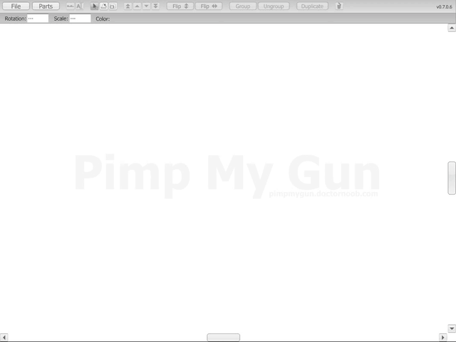
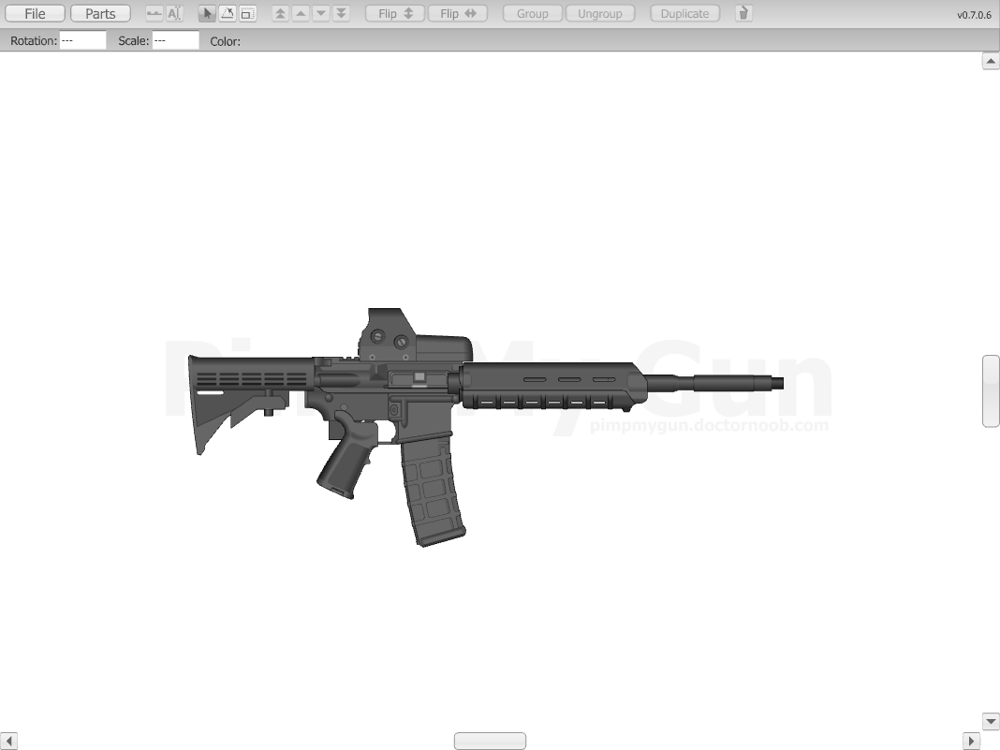
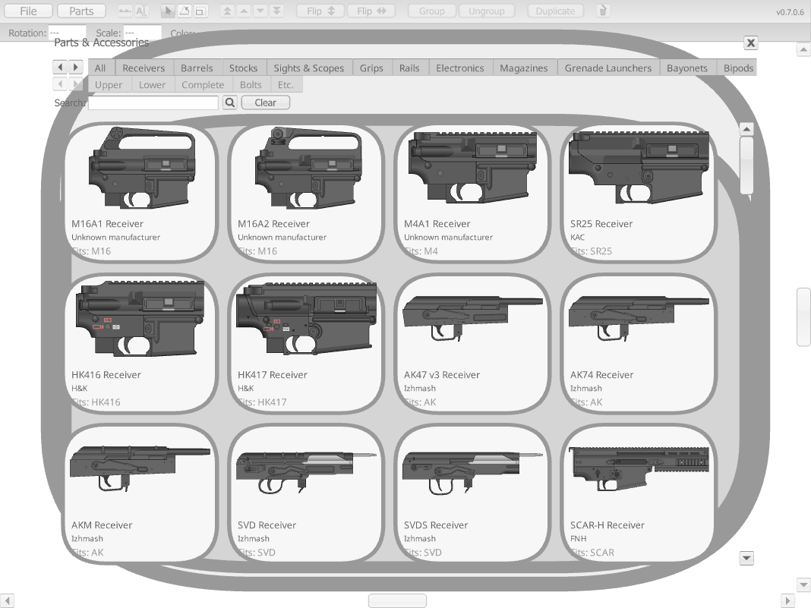
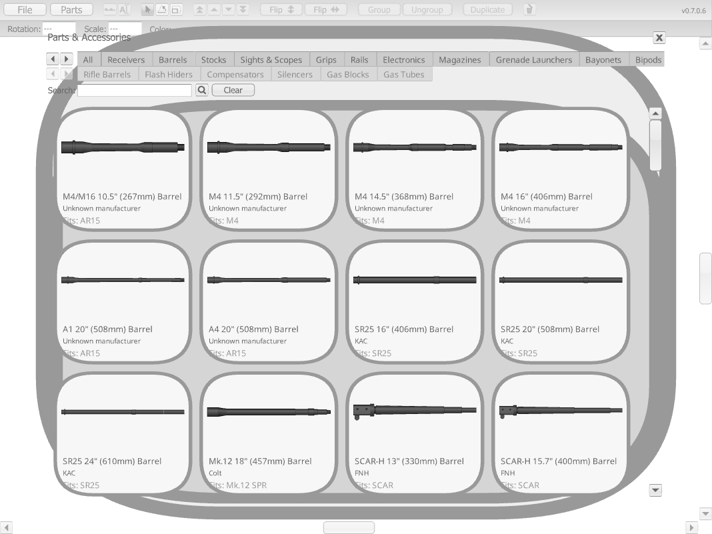
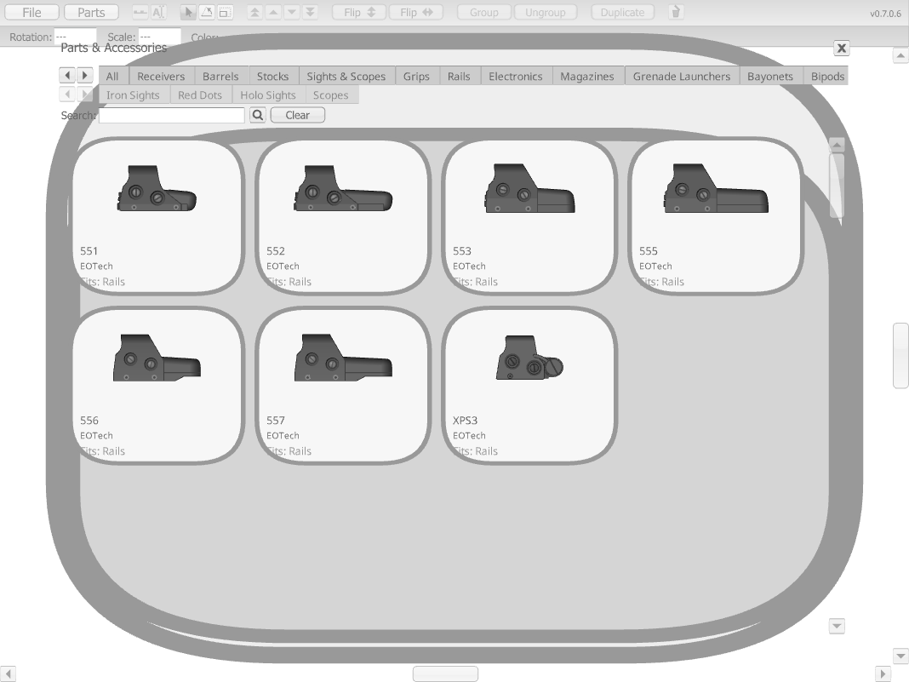

# Pimp My Gun (Flash game), playable online

**[Play Pimp My Gun in your browser](https://mashdordev.github.io/pimp-my-gun/)**, no Flash plugin needed.

Pimp My Gun is the old Flash gun builder from pimpmygun.doctornoob.com. You pick receivers, barrels, stocks, grips, handguards, magazines, sights and scopes from a parts library of real-world guns (M4, M16, AK, SCAR, HK416, MP5, SVD and more), then drag them together into your own custom rifle and save it as a JPG.

> **Disclaimer:** this is not my game. Pimp My Gun was made by Doctor Noob, and every right to it belongs to its creator. I keep a copy here only to preserve it, so it doesn't become lost media now that Flash is gone from browsers. No rights are claimed over the game or its art. It is hosted with permission. If you are the creator and want it changed or taken down, open an issue.

The full-quality recording is in [media/building-a-gun.mp4](media/building-a-gun.mp4).

## Screenshots

| | |
|---|---|
|  |  |
|  |  |

## How it runs

The original game file is in `game/pimpmygun.swf`, unchanged. `index.html` plays it through [Ruffle](https://ruffle.rs), a Flash emulator written in Rust and WebAssembly, and the page is served by GitHub Pages. The rounded panel borders render thicker than in the original Flash Player; that is a Ruffle rendering quirk and doesn't affect play.

## Sprite archive

The `weapons/` folder is an archive of the game's weapon sprite library, kept as found: 1,178 PNGs of weapon parts, attachments, ammo, complete weapons, cosmetics and the app's own UI pieces.

The folder names are the ones the files had when this archive was made. Many don't match the art: a large number of parts sit in folders named after the wrong product or the wrong category. They are left exactly as they were found.

This copy was taken from the asset library of Dead Reload, a game that builds its guns from these side-view parts. The game's cleaned-up, renamed copy lives in that project; this repository is the untouched original.
